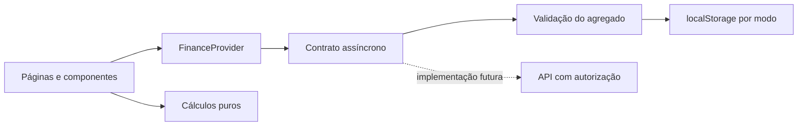

# Arquitetura

## Responsabilidades

`domain/finance.js` contém funções puras para saldo, totais, orçamento, filtro, séries mensais e recorrência. `domain/schemas.js` valida formulários e o agregado financeiro inteiro. A UI formata e apresenta os resultados, sem duplicar as fórmulas financeiras.

`repositories/localRepository.js` implementa o contrato assíncrono com localStorage. `FinanceProvider` coordena leitura, operações, feedback e atualização das telas. Preferências ficam em repositório separado. `services/` gera demonstração e exportações. As páginas compõem componentes reutilizáveis, e React Router mantém URLs diretas.

## Invariantes

- Valores financeiros são inteiros seguros em centavos; entradas com mais de duas casas são rejeitadas, sem arredondamento silencioso.
- Datas financeiras são strings `YYYY-MM-DD`, sem timestamp. `parseISO` faz a apresentação local sem tratar a data como meia-noite UTC. A data padrão usa `America/Sao_Paulo`.
- Transferência exige origem e destino existentes e distintos, sem categoria.
- Receita e despesa exigem categoria do mesmo tipo, sem destino.
- Todo vínculo deve existir, inclusive em um backup importado.
- Um único orçamento por categoria de despesa e mês.
- Alterações inválidas não chegam ao armazenamento.
- Exclusões não removem dependências em cascata.

## Estado e falhas

Consultar o dashboard, listar registros ou exportar não reserva edição nem grava uma base financeira inexistente. Nesse caso, a demonstração é apresentada em memória e o modo pessoal permanece vazio, sem substituir qualquer conteúdo existente.

A edição exige **Ativar edição**. A página recarrega e tenta reservar uma única editora por modo antes da primeira leitura financeira do novo documento. Uma sessão que já leu dados ou foi suspensa não pode assumir edição sem essa recarga: isso impede reutilizar snapshots locais potencialmente antigos. A intenção de navegação em sessionStorage contém somente modo, mês e filtro de conta, não dados financeiros nem um lock; só é aceita em uma recarga e não concede permissão a uma aba nova ou ao Voltar.

A reserva usa Web Locks. O contexto observa seu estado e expõe `canWrite`; o aviso de edição permanece visível e todos os controles de mutação financeira ficam desabilitados na consulta. Navegação, filtros, tema, CSV e backup continuam disponíveis. Os métodos de escrita também verificam a reserva, independentemente da interface.

Uma mutação relê o agregado, aplica a alteração, valida e grava uma única chave. Operações da editora são serializadas; alterações/exclusões verificam o registro original. A operação só é confirmada após ler de volta o JSON gravado e comparar os bytes. Falha nativa de cota preserva o valor anterior. Se não for possível confirmar uma gravação, a mensagem pede conferir os dados e não afirma que houve sucesso ou preservação garantida.

`pagehide`, encerramento explícito e troca de modo liberam a reserva. Atualizar a editora tenta retomá-la no novo documento; atualizar uma consulta não ativa edição. A navegação SPA, inclusive Voltar entre rotas internas, mantém a editora. No retorno de outro documento por BFCache, a sessão antiga permanece sem escrita, fecha formulários e atualiza a leitura. Para voltar a editar, é necessária ativação com nova recarga. Os testes de BFCache usam o canal Chromium completo, removem a flag que o Playwright usa para desabilitá-lo e registram a identidade do documento, `pageshow.persisted` e motivos de não restauração quando disponíveis.

A aplicação observa eventos `storage` somente da base financeira ativa para atualizar as consultas. Preferências de tema/modo não provocam uma leitura financeira intermediária durante a aquisição da reserva.

Leituras inválidas abrem a página de recuperação. O conteúdo bruto pode ser baixado antes de importar outro arquivo. Não há restauração automática de dados corrompidos. Um Error Boundary cobre erros inesperados de renderização.

Modo pessoal e demonstração têm chaves distintas; restauração afeta somente o modo ativo. Modo e tema são persistidos. O período e a conta são estado de sessão; relatórios aceitam intervalo próprio. A soma de saldos sempre representa o estado atual, enquanto receitas, despesas e gráficos têm seus filtros indicados na tela.

## Limites conscientes

O storage local é síncrono internamente, apesar da interface assíncrona. Ele tem cota e não fornece criptografia própria, autenticação, controle de acesso ou transações de banco. A proteção atual exige ativação explícita e uma única aba editora por modo; não é uma funcionalidade colaborativa. Sem Web Locks/HTTPS, dados existentes podem ser lidos/exportados, mas não editados. Na atualização futura aprovada para produção, fechar/recarregar todas as abas antigas antes de editar, pois versões anteriores não respeitam os novos bloqueios. Uma API futura deverá aplicar concorrência e autorização no servidor. Não há promessa de armazenamento ilimitado ou sincronização.

Recorrências usam descrição normalizada, categoria e conta, exigindo três meses distintos. A média é por lançamento; padrões não são garantias de gastos futuros. Filtros de conta em orçamento restringem o numerador e mantêm o limite global, explicitamente indicado na página.

O Bootstrap fornece base de formulários, botões e tabelas. CSS próprio define tokens de tema, layout, cartões e breakpoints. Bibliotecas de gráficos, formulários e framework são divididas em chunks de build. As fontes são locais; não há dependência de Google Fonts em execução.
