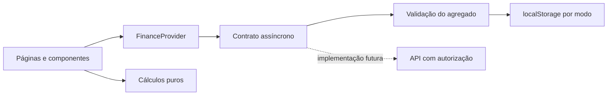

# Arquitetura

## Responsabilidades

`domain/finance.js` contém funções puras para saldo, totais, orçamento, filtro, séries mensais e recorrência. `domain/schemas.js` valida formulários e o agregado financeiro inteiro. A UI formata e apresenta os resultados, sem duplicar as fórmulas financeiras.

`repositories/localRepository.js` implementa o contrato assíncrono com localStorage. `FinanceProvider` coordena leitura, operações, feedback e atualização das telas. Preferências ficam em repositório separado. `services/` gera demonstração e exportações. As páginas compõem componentes reutilizáveis, e React Router mantém URLs diretas.

## Invariantes

- Valores financeiros são inteiros seguros em centavos; entradas com mais de duas casas são rejeitadas, sem arredondamento silencioso.
- Datas financeiras são strings `YYYY-MM-DD`, sem timestamp. `parseISO` faz a apresentação local sem tratar a data como meia-noite UTC. A data padrão usa `America/Sao_Paulo`.
- Transferência exige origem e destino existentes e distintos, sem categoria.
- Receita e despesa exigem categoria do mesmo tipo, sem destino.
- Todo vínculo deve existir, inclusive em um backup importado.
- Um único orçamento por categoria de despesa e mês.
- Alterações inválidas não chegam ao armazenamento.
- Exclusões não removem dependências em cascata.

## Estado e falhas

Uma mutação relê o agregado, aplica a alteração, valida e grava uma única chave. Uma aba editora por modo é eleita com Web Locks; a reserva dura até fechar/recarregar a página. As demais abas podem ler e exportar, mas suas escritas são rejeitadas com instruções para fechar a editora e recarregar. Operações da mesma aba são serializadas e alterações/exclusões da UI verificam o registro esperado para rejeitar formulários desatualizados. `setItem` só substitui o valor após sucesso. Erros de cota ou permissão preservam o valor anterior. A aplicação observa eventos `storage` para atualizar abas abertas.

Leituras inválidas abrem a página de recuperação. O conteúdo bruto pode ser baixado antes de importar outro arquivo. Não há restauração automática de dados corrompidos. Um Error Boundary cobre erros inesperados de renderização.

Modo pessoal e demonstração têm chaves distintas; restauração afeta somente o modo ativo. Modo e tema são persistidos. O período e a conta são estado de sessão; relatórios aceitam intervalo próprio. A soma de saldos sempre representa o estado atual, enquanto receitas, despesas e gráficos têm seus filtros indicados na tela.

## Limites conscientes

O storage local é síncrono internamente, apesar da interface assíncrona. Ele tem cota e não fornece criptografia própria, autenticação, controle de acesso ou transações de banco. A proteção atual exige uma única aba editora por modo; não é uma funcionalidade colaborativa. Sem Web Locks/HTTPS, dados existentes podem ser lidos/exportados, mas não editados. Na atualização futura aprovada para produção, fechar/recarregar todas as abas antigas antes de editar, pois versões anteriores não respeitam os novos bloqueios. Uma API futura deverá aplicar concorrência e autorização no servidor. Não há promessa de armazenamento ilimitado ou sincronização.

Recorrências usam descrição normalizada, categoria e conta, exigindo três meses distintos. A média é por lançamento; padrões não são garantias de gastos futuros. Filtros de conta em orçamento restringem o numerador e mantêm o limite global, explicitamente indicado na página.

O Bootstrap fornece base de formulários, botões e tabelas. CSS próprio define tokens de tema, layout, cartões e breakpoints. Bibliotecas de gráficos, formulários e framework são divididas em chunks de build. As fontes são locais; não há dependência de Google Fonts em execução.
